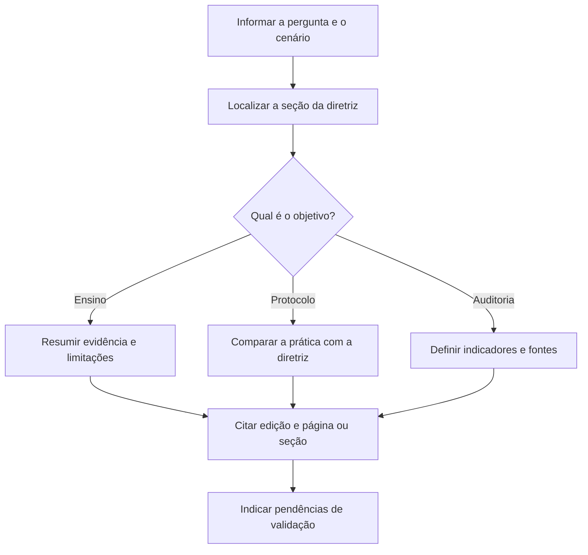

# Transfusão no Trauma

**Skill para ensino, revisão de protocolos de hemorragia maciça e auditoria transfusional.**

[English](README.en.md) · [Instalação](#instalação) · [Fluxograma](#fluxograma-de-revisão) · [Instruções da skill](SKILL.md)

A skill ajuda a localizar e citar a evidência, identificar o que precisa de validação no serviço e adaptar o produto a três usos.

| Uso | O que a skill prepara |
| --- | --- |
| Ensino | Sínteses, comparações de evidências e simulações com casos fictícios |
| Revisão de protocolo | Comparação entre prática documentada, diretriz e proposta de fluxo |
| Auditoria | Indicadores com população, numerador, denominador, fonte e marcos temporais |

> [!IMPORTANT]
> Esta é uma ferramenta de apoio a ensino e revisão. Na assistência, siga o protocolo vigente e acione as equipes de trauma e hemoterapia conforme o fluxo local.

## Fluxograma de revisão

O fluxograma abaixo descreve **como a skill trabalha**.



## Instalação

### Agentes com Terminal

Com Node.js e npm disponíveis, execute na pasta do projeto. O instalador apresenta os agentes compatíveis.

```bash
npx skills add jocielle-tech/transfusao-no-trauma --skill transfusao-no-trauma
```

Para instalar a skill para todos os destinos de agentes reconhecidos pela CLI no projeto:

```bash
npx skills add jocielle-tech/transfusao-no-trauma --skill transfusao-no-trauma --agent '*' -y
```

Use `-g` para instalação no escopo do usuário. Para selecionar um agente, substitua `'*'` pelo seu identificador.

| Agente | Identificador para `--agent` |
| --- | --- |
| OpenAI Codex | `codex` |
| Claude Code | `claude-code` |
| Cursor | `cursor` |
| GitHub Copilot | `github-copilot` |
| Gemini CLI | `gemini-cli` |
| Google Antigravity | `antigravity` |
| OpenCode | `opencode` |
| Windsurf | `windsurf` |
| Cline | `cline` |
| Roo Code | `roo` |
| OpenClaw | `openclaw` |

Consulte a [lista atual de agentes](https://github.com/vercel-labs/skills/blob/main/docs/agents.md) e a [referência da CLI](https://github.com/vercel-labs/skills/blob/main/docs/commands.md).

### Instalação manual ou por upload

```bash
git clone https://github.com/jocielle-tech/transfusao-no-trauma.git
```

Copie a pasta `transfusao-no-trauma` para o diretório de skills reconhecido pelo agente. Exemplos no escopo do projeto incluem `.agents/skills/` para Codex e `.claude/skills/` para Claude Code. Para Claude web ou desktop, compacte a pasta da skill em ZIP e envie em **Personalizar → Habilidades** se o recurso estiver disponível na conta. A descoberta e a ativação variam por produto. [Especificação Agent Skills](https://agentskills.io/specification) · [Guia do Claude](https://support.claude.com/en/articles/12512180-use-skills-in-claude)

## Exemplos de uso

| Quero… | Exemplo de pedido |
| --- | --- |
| Preparar uma aula | “Use a skill transfusao-no-trauma para montar uma aula sobre transfusão pré-hospitalar, com fontes e questões para discussão.” |
| Revisar o protocolo local | “Compare os critérios documentados de ativação e encerramento com a diretriz do ACS e identifique o que exige validação pela hemoterapia.” |
| Auditar o fluxo | “Proponha indicadores para o intervalo entre ativação e primeira transfusão e para o destino dos hemocomponentes liberados.” |

## Fonte clínica

American College of Surgeons Trauma Quality Programs. *Best Practices Guidelines for Transfusion in Trauma*. Novembro de 2026. Consulte a edição e a paginação aplicáveis antes de usar limiares, metas fisiológicas, doses ou detalhes de compatibilidade. [Índice oficial do ACS](https://www.facs.org/quality-programs/trauma/quality/best-practices-guidelines/) · [PDF de novembro de 2026](https://www.facs.org/media/4y2arm2q/acs-tqp-best-practices-for-transfusion.pdf)
